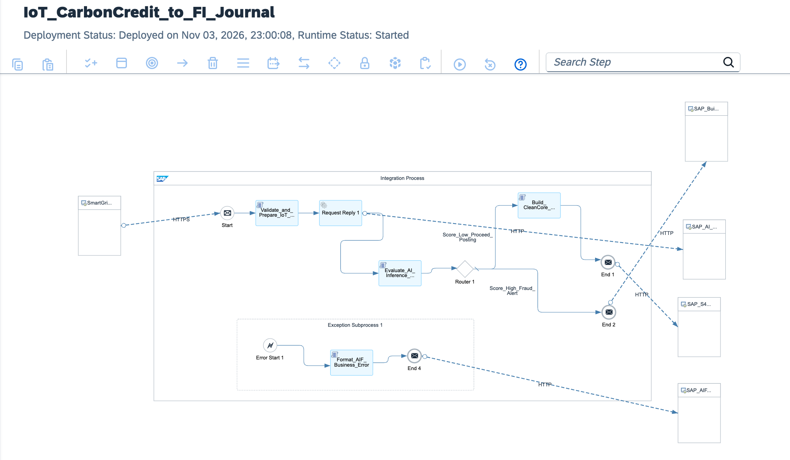

# Enterprise GreenTech Modernization: IoT Smart Meter Telemetry, SAP AI Core Anomaly Detection & S/4HANA Clean Core Ledger

[](https://www.sap.com)
[](https://www.sap.com)
[](https://ghgprotocol.org)
[](https://www.sap.com)
[](https://www.sap.com)

---

## Executive Summary

Global manufacturing plants, real estate portfolios, and utility operators face rigorous sustainability reporting mandates under the EU Corporate Sustainability Reporting Directive (**CSRD**) and **GHG Protocol Scope 1 & 2**. Traditional ESG architectures relied on manual energy auditing spreadsheets and monthly utility bills, creating retrospective data lags, unverified carbon liability estimations, and zero detection of industrial energy leaks or faulty telemetry meters.

This architecture delivers a **Production-Grade GreenTech Intelligence Pipeline**:
1. **High-Frequency IoT Telemetry Ingestion:** Ingests sub-hourly energy, water, and industrial gas consumption readings from smart meters via authenticated HTTPS webhooks and MQTT gateways.
2. **In-Flight Feature Engineering:** Computes rolling energy consumption deltas, kilowatt-hour (kWh) normalized metrics, and emission factors in-memory using optimized Groovy script engines.
3. **SAP AI Core Machine Learning Inference:** Evaluates telemetry feature vectors in real time via REST against a trained **Isolation Forest / Autoencoder ML model** hosted on SAP AI Core, generating automated anomaly scores (0.0 to 1.0).
4. **Clean Core Carbon Accounting Postings:** Automatically routes verified readings to SAP S/4HANA Cloud via standard **OData V4 Journal Entry APIs**, committing instantaneous carbon emission liabilities directly to the General Ledger without custom ABAP modifications.
5. **Anomaly Quarantine & ESG Audit DLQ:** Quarantines suspected pipeline leaks, sensor tampering, or statistical consumption spikes (`AnomalyScore > 0.85`) to an encrypted audit queue, triggering operational alerts before financial reconciliation.

---

## Architecture Overview



### High-Level Topology

```text
[Smart Meter IoT Gateways / Edge Industrial Sensors]
          │
          │ HTTPS POST (TLS 1.3 / OAuth 2.0 Bearer)
          │ Endpoint: /greentech/smartmeter/telemetry/ingest
          ▼
[SAP Integration Suite: IF_GreenTech_SmartMeter_AI_to_S4HANA]
  │
  ├── 1. Context & Emission Profile Initialization (CM_Init_ESG_Context):
  │    └─ Sets Sensor Hardware ID, Facility Code, Grid Emission Factor, and UTC Timestamp
  │
  ├── 2. Feature Vector Engineering (Prepare_AI_Feature_Vector.groovy):
  │    ├─ Computes delta consumption: ΔkWh = CurrentReading - PreviousReading
  │    ├─ Calculates Scope 2 CO2e emission: kgCO2e = ΔkWh * GridFactor
  │    └─ Assembles JSON inference payload for SAP AI Core deployment
  │
  ├── 3. SAP AI Core Anomaly Inference (Request-Reply):
  │    └─ HTTP Outbound Adapter to SAP AI Core REST API (/v2/inference/deployments/{id})
  │
  ├── 4. Anomaly Evaluation & Routing (Evaluate_ML_Anomaly_Score.groovy):
  │    ├─ Extracts inference response: AnomalyScore (Float [0.0..1.0]) & Confidence
  │    │
  │    ├──► [Anomaly Detected (AnomalyScore > 0.85)] ──► CM_Quarantine_Spike ──► DLQ
  │    │      └─ Flags potential leakage / meter malfunction; halts automated ledger entry
  │    │
  │    └──► [Verified Normal (AnomalyScore <= 0.85)] ──► Continue to ERP Commit
  │
  ├── 5. Clean Core Ledger Payload Builder (Build_S4HANA_Carbon_Journal_Entry.groovy):
  │    └─ Formats standard S/4HANA OData V4 Journal Entry batch payload
  │
  ├── 6. Outbound S/4HANA Dispatch:
  │    └─ HTTP OData V4 Adapter (/sap/opu/odata4/sap/api_journalentry/srvd_a2x)
  │
  └── 7. Exception Subprocess (Format_GreenTech_DLQ.groovy):
       └─ Persists telemetry communication or parsing failures to secure ESG DLQ
```

---

## Technical Specifications

| Architectural Dimension | Legacy ESG Retrospective Reporting | Clean Core AI GreenTech Pipeline |
| :--- | :--- | :--- |
| **Data Ingestion** | Monthly manual spreadsheet data entry | Real-time automated smart meter telemetry streaming |
| **Leak / Anomaly Detection** | Undetected until quarterly utility reconciliations | Sub-second ML inference scoring via SAP AI Core |
| **Emission Calculation** | Static annual generalized averages | Dynamic location/grid-based carbon emission coefficients |
| **ERP Carbon Ledger** | Manual journal entries posted by accountants | Automated transactional OData V4 Journal Entry postings |
| **Audit Compliance** | Incomplete audit trail; high non-compliance risk | Immutable telemetry provenance compliant with EU CSRD |
| **ERP Extensibility** | Custom Z-tables and intrusive user-exits | 100% Clean Core compliant; standard financial APIs |

---

## Sample Data Structures

### 1. Inbound Smart Meter Reading
```json
{
  "sensorId": "MTR-SMART-ELEC-DE-104",
  "facilityCode": "PLANT-MUNICH-01",
  "readingTimestamp": "2026-11-07T21:45:00Z",
  "metricType": "ELECTRICITY_KWH",
  "currentCumulativeReading": 84219.45,
  "deltaReadingKWh": 1420.50,
  "operatingVoltage": 400.2,
  "ambientTemperatureCelsius": 18.5
}
```

### 2. SAP AI Core Inference Evaluation
```json
{
  "deploymentId": "dep-ai-core-anomaly-v2",
  "prediction": {
    "anomalyScore": 0.08,
    "classification": "NORMAL_OPERATION",
    "confidenceInterval": 0.992,
    "modelIdentifier": "isolation-forest-energy-v2.4"
  }
}
```

### 3. S/4HANA Carbon Accounting Journal Entry (OData V4)
```json
{
  "CompanyCode": "1010",
  "DocumentDate": "2026-11-07",
  "PostingDate": "2026-11-07",
  "AccountingDocumentType": "SU",
  "DocumentHeaderText": "ESG Scope 2 Carbon Liability - Plant Munich",
  "to_Item": [
    {
      "GLAccount": "65100000",
      "AmountInTransactionCurrency": 284.10,
      "TransactionCurrency": "EUR",
      "DebitCreditCode": "S",
      "CostCenter": "CC-DE-1010-MFG",
      "ItemText": "Electricity Consumption: 1420.5 kWh (568.2 kgCO2e)"
    },
    {
      "GLAccount": "21100000",
      "AmountInTransactionCurrency": -284.10,
      "TransactionCurrency": "EUR",
      "DebitCreditCode": "H",
      "ItemText": "Accrued Energy & Carbon Utility Payable"
    }
  ]
}
```

---

## Repository Structure

```text
├── README.md                                             # Enterprise architecture & operations runbook
├── sap-cpi-greentech-ai-runtime-architecture.png         # Integration flow runtime topology diagram
├── ADR-009-GreenTech-AI-Core-Clean-Core-Ledger.md       # Architecture Decision Record
├── IF_GreenTech_SmartMeter_AI_to_S4HANA.zip              # Production iFlow runtime bundle export
├── cpi/
│   └── scripts/
│       ├── Prepare_AI_Feature_Vector.groovy              # Feature engineering & telemetry normalization
│       ├── Evaluate_ML_Anomaly_Score.groovy              # AI inference parser & threshold router
│       ├── Build_S4HANA_Carbon_Journal_Entry.groovy      # Clean Core OData V4 Journal Entry builder
│       └── Format_GreenTech_DLQ.groovy                   # ESG exception & telemetry dead-letter handler
├── tests/
│   ├── sample_valid_meter_telemetry.json                 # Standard valid telemetry payload
│   └── sample_anomaly_leak_telemetry.json                # Spike payload triggering AI anomaly quarantine
└── .gitignore                                            # Git exclusion rules
```

---

## Verification & Deployment Runbook

### 1. Inbound Endpoint Verification
Verify runtime status in **Monitor** ──► **Manage Integration Content**:
```text
https://<tenant-runtime>.cfapps.<region>[.hana.ondemand.com/http/greentech/smartmeter/telemetry/ingest](https://.hana.ondemand.com/http/greentech/smartmeter/telemetry/ingest)
```

### 2. Dispatched cURL Test (Happy Path)
Execute an authorized POST request using valid smart meter readings:

```bash
curl -X POST \
  'https://<tenant-runtime>.cfapps.<region>[.hana.ondemand.com/http/greentech/smartmeter/telemetry/ingest](https://.hana.ondemand.com/http/greentech/smartmeter/telemetry/ingest)' \
  -H 'Content-Type: application/json' \
  -H 'Authorization: Bearer <BTP_OAUTH_TOKEN>' \
  --data-binary '@tests/sample_valid_meter_telemetry.json'
```

### 3. Monitoring Trace
* Inspect execution under **Monitor Message Processing**.
* Verify properties `Anomaly_Score <= 0.85`, `Scope2_CO2e_Kg`, and `S4HANA_Accounting_Document_ID`.
* Confirm that HTTP 201 Created is returned with the General Ledger accounting document confirmation.

---

## Author

**Željko Popov**  
*Integration Architect | SAP Integration Suite & Clean Core Specialist*  
[GitHub Repositories](https://github.com/neurozeljko)
